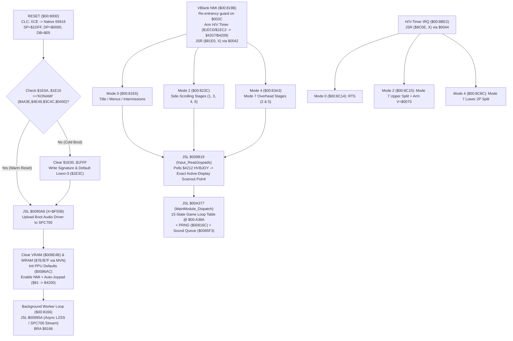

# Contra III: The Alien Wars (USA) — Engine Architecture

This document records the reverse-engineered software architecture of *Contra III: The Alien Wars (USA)* (`SNS-CV-USA`, 1 MB LoROM) and its native C11 runtime + S-PPU1/S-PPU2 scanline rasterizer, derived from static analysis in Ghidra 12.1.4 (`65816:LE:24:snes`) via the REA MCP server.

---

## 1. ROM Header, Vectors & Memory Model

- **Internal Header (`$00:FFC0–$00:FFFF`)**:
  - Title: `"CONTRA3 THE ALIEN WAR"` (`21` ASCII bytes)
  - Map Mode: `$20` / ROM Makeup `$53` (`LoROM`, 1 MB / `8 Mbit`, 32 banks of `32 KB` mapped at `$00–$1F:$8000–$FFFF` and mirrored at `$80–$9F:$8000–$FFFF`)
  - Checksum / Complement: `0x0C3C` / `0xF3C3`
- **65816 Native Hardware Vectors**:
  - `RESET` (`$00:FFFC`, emulation entry): `$00:8000` (`bank00_func_8000`, immediately executes `CLC; XCE` into 65816 native mode)
  - `NMI` (`$00:FFEA`, native VBlank): `$00:819B` (`bank00_func_819b`)
  - `IRQ` / `BRK` / `COP` (`$00:FFEE`, `$00:FFE6`, `$00:FFE4`): `$00:8BE2` (`bank00_func_8be2`)
- **Konami `DB = $05` Data Bank Convention (and `RESET` `MVN` Stack Quirk)**:
  - On `RESET` (`$00:8011`), `NMI_Handler` (`$00:81A9`), and `IRQ_Handler` (`$00:8BF0`), the engine sets **Data Bank Register `DB = $05`** (`SEP #$20; LDA #$05; PHA; PLB`) and **Direct Page `D = $0000`**.
  - Subtle hardware detail in `WarmReset_Entry` (`$00:80A3`): at `$00:80D3`, `PHB` pushes `0x05` to `$00:1DFF` right before `$00:80E3: MVN $00,$00` (`A=$1DFE, X=$0000, Y=$0001`) zeroes `$00:0001–$00:1DFF` inclusive — overwriting the saved `DB` byte on the stack with `0x00`! Thus `PLB` at `$00:80E6` sets `DB = $00` for the background loop (`$00:8166`), while every `NMI_Handler` (`$00:819B`) and `IRQ_Handler` (`$00:8BE2`) sets `DB = $05` for all active frame logic and restores `DB` + `P` (`RTI`) on exit.
  - Because SNES LoROM maps `$0000–$1FFF` (Low WRAM) and `$2000–$5FFF` (PPU/APU/CPU/DMA MMIO) identically across all system banks `$00–$3F`, setting `DB = $05` lets 16-bit absolute instructions simultaneously address:
    1. Low WRAM (`$0000–$1FFF`),
    2. Hardware MMIO (`$2100–$2183`, `$4200–$437F`), and
    3. **Master Data Bank `$05` (`$05:8000–$05:FFFF`)** for 24-bit actor/stage pointer tables and global lookup tables without switching `DB`!
  - Temporary `DB` switches occur only inside tight data loops (saved/restored or reset to `$05`):
    - `DB = $7E` (`$7E:2000–$7E:FFFF` extended WRAM buffers, LZSS ring buffer, tilemap staging)
    - `DB = $06` (`$00:EB1F` stage layout & collision blocks)
    - `DB = $07` (`$02:953D`, `$03:E93F` Mode 7 overhead map tables)
    - `DB = $08` (`$00:9AE6` CGRAM palette & fade tables)

---

## 2. Dual-Thread Interrupt-Driven Execution Flow

Unlike traditional games that run frame logic in the `RESET` loop and only perform DMA inside `NMI`, *Contra III* runs **100% of gameplay logic inside `NMI_Handler` (`$00:819B`)**, using `RESET`'s main loop strictly as a preemptible background decompression/audio-streaming worker:

### Re-Entrancy Guard (`$003C`) & Synchronous `VBlank_WaitFrame` (`$00:85DF`)
- In `NMI_Handler` (`$00:81C6`), if `$003C != 0`, `NMI_Handler` sets `$003C = $0001` and immediately exits via `RTI` to prevent re-entrant corruption during heavy frames.
- During blocking transitions (e.g., `WarmReset_Entry` `$00:80A3`), the game calls `VBlank_WaitFrame` (`$00:85DF`), which clears `$003C = 0` and spins at `$00:85EA: LDA $3C; BEQ $85EA` waiting for hardware VBlank NMI to increment `$3C`. In single-threaded C11 execution, `tools/translate_rom.py` emits a cooperative `bank00_func_819b(ctx)` trigger at `$00:85EC` whenever NMI is enabled (`$4200 & $80`) and `$3C == 0`, matching hardware interrupt wakeups deterministically.

---

## 3. WRAM Memory Map Highlights

| Address Range | Role |
| :--- | :--- |
| `$00:0000–$00:003F` | Scratch Direct Page temporaries (`$00–$0F`), decompression state (`$10–$2C`), game state (`$32`, `$34`), frame counter (`$3A`), NMI busy flag (`$3C`), fade timer (`$3E`), NMI mode (`$42`), IRQ mode (`$44`), HDMA enable (`$46`), CGRAM buffer ptr (`$48`), VRAM queue ptr (`$4E`), tile staging ptr (`$50`) |
| `$00:0052–$00:006B` | SPC700 command ring-buffer indices & handshake state |
| `$00:0086` | **Stage number** (`1..6`): stepped by the stage-select menu (`$00:A7C8`, wraps at 6) and indexes the stage-intro text table `$00:8428` (`$00:A836`). Writing it during the mode-select fade warps to that stage (`--poke 800:0086=N`) |
| `$00:00E6–$00:00EB` | 32-bit PRNG state (`$E8` low word, `$EA` high word; stepped by `$00:816C`) |
| `$00:0100–$00:01FF` | Sound command ring buffer (`$00:868F` enqueue / `$00:85F3` dequeue) |
| `$00:0200–$00:11FF` | Active Actor / Player / Projectile / Boss entity table (`64-byte` slots indexed by `X` or `D`) |
| `$00:1300–$00:137F` | Dual-channel LZSS / VRAM graphics decompression state frames (`D = $1300` for `BG` / Mode 7, `D = $1340` for `OBJ`) |
| `$00:1380–$00:143F` | BG1 / BG2 / BG3 scroll & velocity descriptors (`$1380` BG1, `$13C0` BG2, `$1400` BG3) |
| `$00:1800–$00:187F` | Unrolled fast VRAM DMA slot descriptors (`$00:A257` / `$00:A291`) |
| `$00:1C00–$00:1DFF` | Menu / Stage-intro state variables (`$1C00–$1CFF`) & Native Hardware Stack (`S` starts at `$1DFF`) |
| `$00:1E02` | Title-menu selection / player mode (`0` = 1 PLAYER, `1` = 2 PLAYERS A, `2` = 2 PLAYERS B, `3` = OPTION; cursor wraps at `$00:B27D`). The attract demo forces `1` (`$00:A603`) for its 2-player demos. Not the stage number |
| `$00:1F8A` / `$00:1FCA` | Player 1 / Player 2 remaining lives (`0` = on the last life) |
| `$00:0200` / `$00:0240` | Player 1 / Player 2 actor slots (`+$06` screen X, `+$0E` screen Y in side-scrolling stages) |
| `$00:1E00–$00:1FFF` | Persistent configuration, `"KONAMI"` boot magic (`$1E0A–$1E10`), starting lives (`$1E3C`), difficulty (`$1E3E`), PPU register shadows (`$1E80–$1EC4`), Mode 7 IRQ matrix buffers (`$1FA0–$1FF5`), 1P/2P scores & lives (`$1F80–$1FF9`) |
| `$7E:0FC0–$7E:11DF` | 544-byte Sprite OAM shadow buffer (DMA'd to `$2104` every VBlank by `$00:8452`) |
| `$7E:2200–$7E:23FF` | 512-byte CGRAM palette shadow buffer (DMA'd to `$2122` every VBlank by `$00:8452`) |
| `$7E:2C00–$7E:2FFF` | 1 KB Konami LZSS sliding-window decompression buffer (`$00:94A9`) |
| `$7E:3000–$7E:33FF` | Queued VRAM DMA command list (`11-byte` records processed by `$00:8CFB`) |
| `$7E:D000–$7E:D3FF` | Double-buffered dynamic HDMA tables (`MVN $7E,$7E` copied from `$D000` -> `$D200` during VBlank) |

---

## 4. Subsystems & Dispatch Tables

### 4.1 Master Game Loop (`$00:A377` — `MainModule_Dispatch`)
Indexed by `$0032` (`0x00`..`0x0E`) via inline jump table `$00:A38A` (`15` states):
- `0x00` (`$00:A3A8`): Konami logo laser-beam & cold startup sequence
- `0x01` (`$00:A3E4`): Pre-intro transition
- `0x02` (`$00:A3E5`): `"A.D. 2636"` Neo Kobe City intro cinematic sequence
- `0x03` (`$00:A587`): **Title Screen** (`1 PLAYER`, `2 PLAYERS A`, `2 PLAYERS B`, `OPTION` — Mode 7 top 128 lines + Mode 1 bottom 96 lines via HDMA `$46=1`)
- `0x04` (`$00:A5E0`): Attract Mode automated gameplay demos (Stage 1/3 co-op & Stage 2 Mode 7 split-screen)
- `0x05` (`$00:A625`): Options screen (`Lives`, `Difficulty`, `Control`, `Sound`)
- `0x06`–`0x08`: Stage briefing, character/weapon entry, transitions
- `0x09` (`$00:A8E1` / `$00:BD40`): **Active Gameplay** (`Gameplay_MainStep`, table `$00:BD57`)
- `0x0A`–`0x0E`: Game over / continue countdown, stage clear tally, final boss transitions, ending & credits

### 4.2 24-Bit Cross-Bank Dispatch Tables in Bank `$05`
1. **`$05:A0B4` (`26` entries, dispatched at `$00:E355` via `JML [$0000]`)**:
   - Stage-specific background event / scroll / boss-room controllers spanning Banks `$00`, `$01`, `$02`, `$04`.
2. **`$05:A48A` (`160` entries + slot `0` null, dispatched at `$00:EB04` via `JML [$0000]`)**:
   - Master Actor / Enemy / Boss update table spanning Banks `$00`, `$01`, `$02`, `$04`, and `$1D`.

### 4.3 Konami LZSS Decompressor (`$00:94A9`)
- Stream-oriented decompressor operating in incremental chunks into a `1,024`-byte circular window (`D = $1300`, `$1340`, or `$1F00` holds stream state so BG, OBJ, and SPC700 audio streams decompress concurrently).
- Supports 5 command encodings on control byte `B`:
  - `B < 0x80`: Sliding-window LZ copy (`length = (B >> 2) + 2`, `10-bit` window offset).
  - `0x80 <= B < 0xA0`: Literal run (`length = B & 0x1F` bytes copied raw from ROM stream).
  - `0xA0 <= B < 0xC0`: Zero-byte RLE (`length = (B & 0x1F) + 2` zeroes).
  - `0xC0 <= B < 0xE0`: Single-byte RLE (`length = (B & 0x1F) + 2` copies of next byte).
  - `B >= 0xE0`: Alternating zero-high-byte word fill (`length = (B & 0x1F) + 2` pairs).

### 4.4 Unreferenced *Contra Spirits (Japan)* Cheat Subroutines in Bank `$00`
Static gap analysis of Bank `$00` uncovered three intact, RTS-terminated subroutines immediately following `$00:B2DD` that Konami disconnected when localizing *Contra Spirits* (`SHVC-CS`) into *Contra III: The Alien Wars* (`SNS-CV-USA`):
- **`$00:B2F3` (`bank00_func_b2f3`)**: Sound Test activation (`SFX $3E`).
- **`$00:B346` (`bank00_func_b346`)**: 30-Lives cheat (`0x001E` -> `$1E3C`, `SFX $43`).
- **`$00:B39F` (`bank00_func_b39f`)**: Stage Select unlock (`0x0001` -> `$1E60`, `SFX $59`).

---

## 5. S-PPU1 / S-PPU2 Scanline Software Rasterizer (`src/snes_ppu.c`)

### 5.1 Tear-Free VBlank -> Active-Display Scanout Hook (`$4212` `CPUIO_HVBJOY`)
Across all three `NMI_Handler` modes (`$00:81E6`, `$00:823C`, `$00:83A3`), *Contra III* executes 100% of VBlank VRAM/OAM/CGRAM DMAs, scroll write-twice latches, PPU shadow flushes (`$00:84AE`), HDMA channel setup (`$00:8BA7`), and `STA $2100` unblanking *before* calling `Input_ReadJoypads` (`$00:8B19`), which polls `$4212` (`CPUIO_HVBJOY`) immediately prior to `MainModule_Dispatch` (`$00:A377`).
`snes_step_frame` attaches a lightweight read hook on `CPUIO_HVBJOY` that invokes `snes_ppu_render_frame` at that exact cycle boundary — capturing the pristine PPU/VRAM/OAM/CGRAM/HDMA state for active scanout before next-frame game logic modifies WRAM buffers.

### 5.2 Ricoh 5A22 HDMA `NTRL` (`$43xA`) Borrow Semantics
On the Title Screen (`$46 = 1`, table `$05:84FE`), HDMA Channel 7 writes `$2105` (`BGMODE`) from `$05:850F` (`80 0F 01 09 00`) and Channel 6 writes `$212C` (`TM`) from `$05:8514` (`80 11 01 04 00`):
- Line counter `0x80` specifies **128 non-repeat scanlines** of Mode 7 (`BGMODE = $0F`, `TM = $11`) for the zooming *Contra III* logo, followed by `0x01` switching scanlines `128..223` into Mode 1 (`BGMODE = $09`, `TM = $04`) for the BG3 menu text!
- `ppu_hdma_step_scanline` reproduces the exact 8-bit 5A22 down-counter (`--line_counter`): decrementing `0x80` borrows from bit 7 to yield `0x7F`, naturally clearing bit 7 (`repeat = false`) for the next `127` scanlines while `0x81..0xFF` keep bit 7 set (`repeat = true`).

### 5.3 Multi-Split Mode 7 + V-IRQ Overhead Stages (Stages 2 & 5)
During scanline iteration (`y = 0..223`), `snes_ppu_render_frame` checks `(ctx->cpu_io.nmitimen & 0x20) && y == ctx->cpu_io.vtime`:
1. At the upper HUD boundary, `bank00_func_8be2` -> `bank00_func_8c15` (`$00:8C15`) loads Player 1's Mode 7 affine matrix (`$1FA4–$1FB3` -> `M7A..M7Y`, `BG1HOFS`, `BG1VOFS`).
2. In 2-player split-screen mode (`$0040 != 0`), `bank00_func_8c15` dynamically re-arms `VTIME = $0070` (`y = 112`) and `$0044 = $0004`, causing `snes_ppu_render_frame` to fire `bank00_func_8be2` -> `bank00_func_8c8c` (`$00:8C8C`) mid-frame at scanline `112` to load Player 2's independent Mode 7 rotation matrix (`$1FE4–$1FF3`).

### 5.4 Presentation Layer: OpenGL 3.3 Core with GDI Fallback (`src/win32_gl.c`)
- **Context creation**: `ChoosePixelFormat` + a bootstrap `wglCreateContext`, then `wglCreateContextAttribsARB` for a **3.3 Core** context. If the driver offers only a compatibility context of 3.3 or newer, that is used instead; anything older falls back to GDI. Only `opengl32.dll` is linked, and every entry point newer than GL 1.1 is resolved through `wglGetProcAddress`.
- **Per frame**: the `256 x 224` ARGB8888 buffer is uploaded with `glTexSubImage2D(GL_BGRA, GL_UNSIGNED_INT_8_8_8_8_REV)` (no CPU swizzle) into one `GL_RGBA8` texture, then a single attribute-less full-screen triangle (`gl_VertexID`) is drawn into the aspect-correct (optionally integer-snapped) viewport.
- **Filters (GLSL 3.30, `F9`)**: *Sharp-Bilinear* (analytic integer prescale, bilinear only across texel seams), *Nearest* (`texelFetch`), and *CRT* (linear-light Gaussian scanline beams whose width follows luminance, an aperture-grille mask from 2.5x upward, soft barrel curvature and vignette; below 2x vertical scale it falls back to Sharp-Bilinear).
- **Pacing**: with `--vsync` on a 59–61 Hz display, `SwapBuffers` paces frames. Otherwise the existing `QueryPerformanceCounter` 60.0988 Hz loop stays in charge, so VSync never double-waits against the SNES rate.
- **Verification**: `--gl-selftest <prefix>` renders a live Stage 1 frame through every filter, reads the back buffer back with `glReadPixels`, and checks the Nearest 3x output bit-exact against the CPU frame buffer. The GDI `StretchDIBits` path stays selectable with `--gdi` and is the automatic fallback.

### 5.5 2-Player Split-Screen Overhead Behaviour (Stages 2 & 5)
- `$00:8C15` (upper IRQ) and `$00:8C8C` (lower IRQ, scanline `112`) load independent Mode 7 matrices from `$1FA4–$1FB3` and `$1FE4–$1FF3`. HDMA switches scanlines `104..119` to Mode 1 BG3 for the shared 1P/2P HUD band.
- When a player dies or runs out of lives, the game's HDMA table writes `INIDISP = $00` over that player's half, which blacks it out until they respawn (or take a life from their partner). This was confirmed by correlating per-scanline `INIDISP` captures with `$1F8A` / `$1FCA`: it is game behaviour, not a renderer defect.

---

## 6. Sony S-SMP (`SPC700`) & `S-DSP` Audio Architecture (`src/snes_apu.c`)

### 6.1 Cold-Boot IPL Upload (`$05:F55B`) & Driver Startup (`ARAM $0200` -> `$0896`)
1. During `RESET` (`bank00_func_8000` -> `bank00_func_90a8` with `X = $F55B`), the 65816 shakes hands with the 64-byte Sony IPL Boot ROM (`$FFC0–$FFFF`, signature `$BBAA` on `$2140–$2141`) via `bank00_func_937b` and streams three LZSS-decompressed blocks from ROM into the 64 KB Audio RAM (`bank00_func_93ca`):
   - `$1A:A8CA` -> `ARAM $5000` (core sequence / instrument table)
   - `$1B:8002` -> `ARAM $5100` (resident BRR percussion / common SFX bank)
   - `$1A:8002` -> `ARAM $0200` (Konami SPC700 audio engine; `$0200` contains `5F 96 08` = `JMP !$0896`)
2. Upon reading the `$FFFF` script terminator (`$00:9400`), `bank00_func_93ca` writes launch address `$0200` to `$2142–$2143`, `0x00` to `$2141`, increments `$2140`, waits for echo, and executes `STZ $2140` (`$00:9423`).
3. At `$0896`, Konami's SPC700 driver executes `CLRP` (`0x20`), sets `SP = $CF`, writes `0x30` to `$00F1` (disabling the IPL ROM overlay and clearing `$F4–$F7` input latches), zeroes driver work RAM (`$0000–$00EF`, `$0100–$018F`, `$0203–$03E5`), initializes S-DSP registers (`$11A1`), arms Timer 0 (`$00FA`, `8 kHz` stage), and enters its Timer-0-paced main loop (`$0955: MOV Y, !$00FD; BEQ $0955`).

### 6.2 Runtime Sound Queue (`$00:85F3`) & Stage Sample Reload Protocol (`$00:990E` / `ARAM $1AF3`)
- **Per-Frame Command Queue (`bank00_func_85f3`)**: Game code enqueues 8-bit BGM/SFX IDs into `$00:0100–$00:01FF` (`$54` read index, `$56` write index). Once per VBlank, `bank00_func_85f3` sends the next command byte to `$2140` (`APU_PORT0`) and waits across subsequent frames until `$2140` echoes that byte (`$18BC` on SPC700).
- **Warm Stage Sample Reload (`bank00_func_98e2` -> `bank00_func_990e`)**: Between stages and cutscenes, `bank00_func_990e` sends `0x84` (stop all voices) followed by `0xFF` to `$2140`. Rather than jumping back to the Sony IPL ROM, Konami's SPC700 driver at `$18D3` (`CMP A, #$FF`) calls its own resident uploader at `ARAM $1AF3`, which implements an identical `$CC` / rolling-index transfer loop (`$1AFC–$1B30`) into `ARAM $3000+` and finishes with `MOV !$00F1, #$31; RET` (`$1B31–$1B36`).
- **16-Bit Port Write Atomicity & Post-Upload Synchronization**: Because `bank00_func_93ca` (`$00:93E1`) and `bank00_func_990e` (`$00:9938`) perform 16-bit `STA $2140` writes (`APU_PORT0` then `APU_PORT1`), `snes_apu_write_port` latches `$F4–$F7` without mid-word SPC700 stepping, advancing the `1.024 MHz` SPC700 clock during `$2140` polling (`snes_apu_read_port`), on end-of-upload `STZ $2140` (`$2140 == 0 && $2141 == 0`), and across each `60.0988 Hz` video frame (`~532.46` stereo `32,000 Hz` samples/frame in `snes_apu_end_frame`, carrying the `<32`-cycle instruction remainder in `frame_cycles_run = dsp_cycle_accum` for zero dropped or invented DSP samples).

### 6.2a CPU/APU Synchronisation (`snes_apu_sync`, `snes_apu_run_to`)
- Before every 65816 read or write of `$2140–$2143`, `snes_apu_sync` runs the SPC700 + S-DSP up to `snes_spc_time_now(ctx)`, the SPC time matching the CPU's wall time on the shared frame grid (§7.5). The SPC therefore observes each CPU write at the right moment, and every poll iteration of a handshake loop costs real time on both sides. At each frame boundary the APU runs on to the next NMI time.
- This replaces the old per-poll model (24 SPC cycles per read, plus fixed 24,000/512-cycle jumps after uploads, plus a per-frame sample quota that discarded samples beyond about 532.46 per frame). Under that model, during handshake-heavy frames the sound driver ran faster than real time and its output was thrown away.
- Exactly one stereo sample is produced per 32 SPC cycles. Steady play yields 532–533 samples per frame, and loads yield their real elapsed audio. Interactive playback drops excess beyond about 128 ms of queue. Headless `--wav` captures losslessly through the `SnesApu.pcm_sink` callback, because a long load can produce seconds of audio inside one frame, far more than the 0.5 s ring holds.
- Check: against the previous model, gameplay music matches at a constant +10.964 s offset (the modelled load time) measured at 30, 60 and 85 s, so there is no tempo drift. Game-state progress is identical frame for frame.

### 6.3 Silicon-Matched S-DSP Synthesis & `48 kHz` Desktop Reconstruction
- **5-Sample `KON` Startup & BRR Loop Continuity**: Each keyed-on voice (`$4C` polled every 2 samples) waits an exact 5-sample hardware `kon_delay`, preloads its initial 4 BRR samples once via `v->kon_init`, and thereafter advances `brr_addr += 9` (or jumps to its `$5D` `DIR` loop pointer on `header & 0x03 == 0x03`) strictly inside the `next_interp >= 0x1000` shift loop so low-pitched instruments (`pitch < $1000`) never re-decode block `0` prematurely.
- **16-Bit Clamped / 15-Bit Sign-Wrapped BRR, Gaussian & LFSR Noise**: Matches Sony S-DSP silicon bit-for-bit across all 4 BRR IIR filters, 512-entry 4-tap Gaussian table with intermediate 16-bit wrap before tap 4, ADSR `(env >> 8) == SL` Decay-to-Sustain transition, signed 15-bit LFSR white-noise shifts (`NON`), `PMON` pitch modulation, and `ESA`/`EDL`/`EFB` 8-tap FIR stereo echo.
- **`48,000 Hz` 4-Tap Catmull-Rom Host Output (`src/win32_main.c`)**: Live Win32 `waveOut` playback upsamples native `32,000 Hz` S-DSP stereo by an exact `2:3` ratio (`682 -> 1,023` stereo frames = `21.31 ms` per fixed `WAVEHDR` block, `~64 ms` pre-buffer) using symmetric-rounded 4-tap Catmull-Rom cubic interpolation (`upsample_32k_to_48k`) to avoid legacy MME `32 kHz -> 48 kHz` linear-resampler aliasing and WASAPI shared-mode underruns.

---

## 7. Input Movie Co-Simulation Architecture (`src/snes_movie.c`, `tools/`)

### 7.1 Movie Decoding
- **Snes9x `.smv`** v1 (1.43), v4 (1.51), v5 (1.52+): reads the controller mask and per-sample size (including v5 mouse / Super Scope / Justifier bytes), treats a sample with all bytes `0xFF` as a reset, and rejects movies that start from a savestate.
- **BizHawk `.bk2`**: reads the zip central directory, inflates `Input Log.txt` with a built-in RFC 1951 decoder (stored, fixed and dynamic Huffman blocks), and maps characters through the movie's own `LogKey`, so any SNES core column order (`#Reset|Power|#P1 Up|...`) decodes correctly. `Header.txt` supplies the author and rerecord count, and `StartsFromSavestate True` is rejected.
- **`.c3m`**: one line per frame, `P1 P2 [flags]` in hex `$4218` order (flag `1` = reset, `2` = power). It is written by `--record` and by `F6`, which power-cycles first so the movie replays from power-on.

### 7.2 Lag Frames and Alignment
Contra III runs 100% of its game logic inside `NMI_Handler`. On hardware, an overrun frame makes the next NMI hit the `$003C` re-entrancy guard and return immediately, so that frame's joypad state is never read (an emulator *lag frame*). The recompilation services every NMI and never lags. Emulator movies therefore line up with the recompilation's **logic frames**, not wall-clock frames. `tools/emu_trace.lua` records the emulator's lag flag per frame, `--lag-from` skips those movie frames during playback, and `tools/compare_trace.py` drops the same rows from the reference trace before the 1:1 comparison.

### 7.3 Trace Probes (`--trace`, `tools/emu_trace.lua`)
`state $32`, `sub $34`, `nmi_mode $42`, `stage $86`, `frame_ctr $3A`, P1/P2 actor X/Y (`$0206/$020E`, `$0246/$024E`), lives (`$1F8A`, `$1FCA`), camera (`$1380`), and PRNG (`$E8`, `$EA`). The PRNG words are the most sensitive divergence detector, because every enemy-spawn decision consumes them.

### 7.4 Headless Verification (`--verify`)
Prints every game-state, stage and NMI-mode transition, flags a **hang** when the logic frame counter `$3A` stops advancing for `--hang-frames` frames (default 600), and exits `2` on any unresolved indirect jump or `4` on a hang (`--strict` aborts at the first unresolved jump, exit `3`, after printing the dispatch site and registers). `tools/soak_all_stages.py` builds on this: it warps to each stage (`--poke 800:0086=N`), drives a deterministic biased-random input bot for 1P and 2P with `--infinite-lives`, and checks every run.

### 7.5 CPU Time Model (`SNES_CYCLES`, `--lag-model`)
- **Charging**: `tools/translate_rom.py` emits `SNES_CYCLES(ctx, n)` before every instruction, using the WDC 65C816 native-mode table (`insn_cycles`): +1 for 16-bit M or X where it applies, +2 for 16-bit read-modify-write, `SNES_DP_PENALTY` (+1 when `D & $FF != 0`, which is common because Contra III points `D` at 64-byte actor slots), and +1 on taken conditional branches. Dynamic M-width merge points use a `flag_m` ternary. The runtime adds MVN/MVP (7 cycles per byte) and general DMA (1 cycle per byte plus 8 per channel). Page-crossing penalties and the 6/8/12-clock memory-speed split are folded into one average of about 7.6 master clocks per CPU cycle.
- **Budget**: 357,368 master clocks per NTSC frame minus DRAM refresh, divided by 7.6, gives **45,642** CPU cycles (`SNES_LAG_BUDGET_DEFAULT`).
- **Shared timeline** (`snes_step_frame`, `src/snes_runtime.c`): wall time = `cycles + idle_cycles`. NMIs fire on a fixed grid (`nmi_wall`, one budget apart). The SPC700 time at each grid point advances by exactly 1,024,000 Hz ÷ 60.0988 Hz, about 17,038.6 cycles per frame, with an integer running fraction, and wall time maps linearly onto it. If the CPU is still busy when the grid NMI fires, that frame is a lag frame: the hardware `$003C` guard path, no background-worker slices, unchanged scanout. Without `--lag-model` the grid slides to "now" instead, so video never drops frames. Waiting for vblank adds idle time, and so does the main-thread `VBlank_WaitFrame` (`snes_cooperative_nmi`, emitted at `$00:85EC`).
- **Measured load** (soak bot, normal play): Stage 1 1P averages 24.7k cycles with a 99th percentile of 45k. Stage 4 2P averages 32k with a 99th percentile of 59k, and the 2P overhead Stage 2 averages 33k with a 99th percentile of 51k. Multi-million-cycle NMIs occur only at transitions (stage intro, first gameplay frame, stage-clear tally), from synchronous decompression and SPC700 sample uploads.
- **Known gaps**: the cycle costs ignore page crossings and the exact 6/8/12-clock memory-speed split, and the budget hasn't been calibrated against hardware. `tools/compare_trace.py --lag-report` measures recall and precision of lag frames against an emulator trace.

### 7.6 Preemptible Main Thread (`src/snes_mainthread.c`)
- **Model**: on hardware, the RESET code ends in the background loop at `$00:8166` (`JSL $00995A; BRA`). That loop performs long jobs requested by NMI code: `$0052 = $FF` triggers the SPC700 streaming upload at `$00:98E2`. NMIs keep interrupting it every frame, and the game logic in those NMIs waits on `$0052`, so a job that takes N frames of CPU time delays the game by N logic frames.
- **Implementation**: the main thread runs as a coroutine (a Win32 fiber, or POSIX `ucontext`). `SNES_CYCLES`, emitted before every generated instruction, compares `ctx->cycles` with `yield_cycles` and switches back to the host when the CPU's wall time reaches the next NMI. `snes_step_frame` runs the NMI on the host, then calls `snes_mainthread_run_until(next NMI)`. Main-thread VBlank waits (`$00:85DF` spinning at `$00:85EC`) yield until the next NMI, which takes Konami's `$003C` busy path exactly as on hardware. With no job pending, the idle loop skips straight to the next NMI. DMA and MVN/MVP charge cycles without yielding, since an NMI can't split a DMA.
- **Entry points**: `snes_power_on` (`$00:8000`) and `snes_soft_reset` (`$00:80A3`). Boot now spans about 105 video frames before the first logic frame, as on hardware.
- **Save states**: a coroutine stack can't be serialised, so `snes_savestate_save` returns `SNES_SAVESTATE_BUSY` unless the main thread is parked in the idle loop (it almost always is during play). Loading recreates the coroutine in the idle loop.
- **Why it matters**: before this change, a background job finished inside a single frame. Stage 6 2P then diverged from snes9x when a mid-stage upload released the camera lock early. With the preemptible main thread, all 13 equivalence scenarios match.

### 7.7 Reference-Emulator Equivalence (`tools/refemu/`)
- `refemu_trace.c` loads a libretro core (`retro_*` API), reads 128 KB WRAM through `RETRO_MEMORY_SYSTEM_RAM`, and writes the standard trace CSV.
- **Logic-frame detection**: `$3A` is incremented at the start of each logic frame (`$00:A379`) and occasionally reset (`STZ $3A` at `$00:ADBF`). An increment of n counts as n logic frames. A reset counts as one unless that NMI was already counted while it was still running (`$3C ≠ 0` at the previous boundary). The power-on `$5555` → 0 WRAM clear is ignored.
- **Sampling**: each logic frame's row is taken at the end of its last video frame, because an overrunning NMI is still executing when `retro_run` returns. Host rules (pokes, infinite lives) are applied only at boundaries where no NMI is running (`$3C == 0`), matching the recomp's between-NMI point.
- **Input**: the movie advances per logic frame on both sides (`contra3.exe --movie-logic`, `tests/golden` `movie-logic`), so the emulator's lag frames (Konami's busy guard) can't shift the input.
- **Calibration**: every scenario is bit-exact for `--cpu-budget` of about 44,700–45,150; outside that window only the Stage 6 2P upload timing diverges. `SNES_LAG_BUDGET_DEFAULT` is 45,000.

